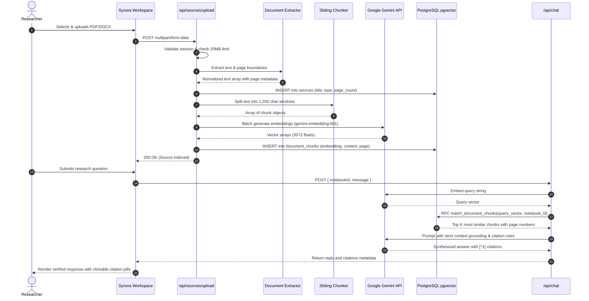
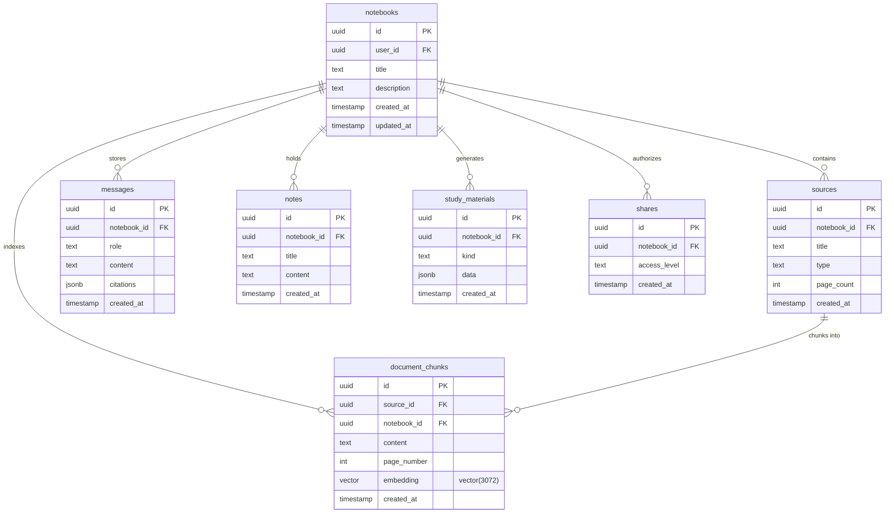
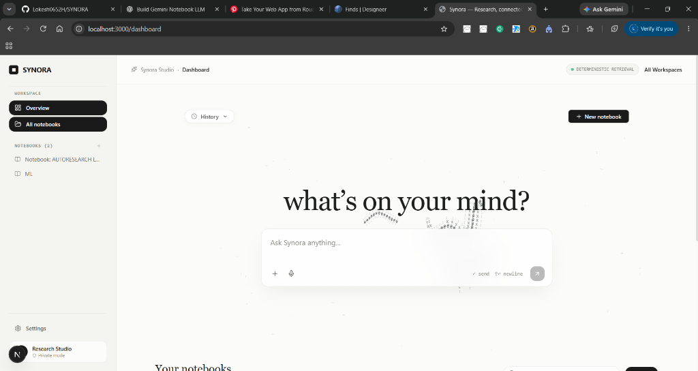
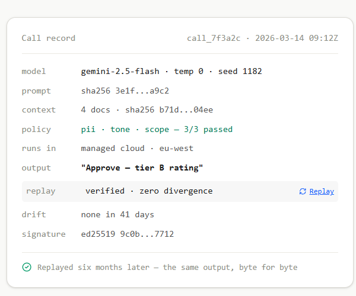

<div align="center">

# SYNORA

**AI-Powered Research, Knowledge Management and Learning Intelligence Platform**

*"Knowledge is not the destination. Understanding is."*

<p align="center">
  
</p>

[](https://nextjs.org/)
[](https://react.dev/)
[](https://www.typescriptlang.org/)
[](https://aistudio.google.com/)
[](https://supabase.com/)
[](https://tailwindcss.com/)
[](https://vitest.dev/)
[](LICENSE)

<p align="center">
  <a href="#section-02--overview">Overview</a> •
  <a href="#section-03--core-capabilities">Capabilities</a> •
  <a href="#section-04--feature-deep-dives">Deep Dives</a> •
  <a href="#section-05--system-architecture">Architecture</a> •
  <a href="#section-06--research-pipeline">Research Pipeline</a> •
  <a href="#section-07--technology-stack">Tech Stack</a> •
  <a href="#section-08--project-structure">Structure</a> •
  <a href="#section-09--installation-and-setup">Quickstart</a> •
  <a href="#section-11--api-documentation">API</a> •
  <a href="#section-13--security-and-privacy">Security</a>
</p>

---

</div>

## SECTION 01 — PREMIUM PROJECT HEADER

SYNORA is an independent, sovereign research intelligence platform engineered for rigorous intellectual work. It synthesizes heterogeneous documents into a unified, cryptographically auditable knowledge graph, grounds every LLM assertion in verifiable source citations with page numbers, and translates dense source corpora into multi-modal learning ecosystems (study guides, active recall flashcards, diagnostic quizzes, conceptual mind maps, and interactive spoken audio briefings).

Designed around an editorial aesthetic of warm ivory, beige, and charcoal, SYNORA eliminates conversational hallucinations by coupling **Google Gemini 2.5 Flash** with **PostgreSQL `pgvector` HNSW indexes** running behind strict **Row-Level Security (RLS)**.

---

## SECTION 02 — OVERVIEW

Modern research workflows suffer from fragmentation: academic papers, clinical trial protocols, legal filings, technical whitepapers, and field notes are scattered across disparate files, disconnected notes apps, and ungrounded LLM chat interfaces that invent plausible-sounding falsehoods.

SYNORA solves this through a unified research environment founded on three core tenets:

1. **Zero Hallucination Tolerance**: Generative models are never permitted to guess. Every claim made in the Research Workspace is retrieved via vector cosine similarity, bound to an exact document passage, and displayed with interactive citation markers.
2. **Deterministic Reproducibility**: Research queries track prompt hashes, context chunk boundaries, temperature seeds, and evaluation metrics, guaranteeing that analysis conducted today can be verified byte-for-byte in the future.
3. **From Extraction to Understanding**: Ingesting sources is only the beginning. SYNORA actively transforms text into structured artifacts: conceptual relationship graphs, contradiction detectors, comparative tables, and multi-speaker audio overviews.

### Who SYNORA is Built For
- **Academic & Scientific Researchers**: Review literature, cross-reference multiple papers, identify methodological discrepancies, and generate comprehensive research bibliographies.
- **Intelligence & Security Analysts**: Ingest high-volume reports, correlate entities across investigations, and audit claims against source documents.
- **Legal & Regulatory Counsel**: Inspect contracts, verify compliance documentation, track statutory precedents, and surface subtle textual contradictions.
- **Engineers & Technical Architects**: Parse system specifications, API guides, and architectural whitepapers into functional roadmaps and implementation action items.

---

## SECTION 03 — CORE CAPABILITIES

SYNORA's capabilities are organized into six functional pillars, validated against the running codebase:

| Capability Pillar | Feature | Status | Description |
| :--- | :--- | :---: | :--- |
| **Research Workspace** | Private Research Notebooks | :white_check_mark: Production | Isolated research domains scoped by UUID with dedicated vector namespaces. |
| | Source Library Organization | :white_check_mark: Production | In-notebook catalog tracking document titles, MIME types, page counts, and indexing status. |
| | Persistent Research Notes | :white_check_mark: Production | Auto-saved markdown notes and key insights linked to notebook context. |
| | Workspace Management | :white_check_mark: Production | Create, rename, switch, and delete notebooks with cascading database cleanups. |
| **Multi-Source Intelligence** | PDF Document Processing | :white_check_mark: Production | Per-page text extraction and pagination tracking via `pdf-parse`. |
| | Word (DOCX) Ingestion | :white_check_mark: Production | Clean body extraction and heading parsing via `mammoth`. |
| | Plain Text & Markdown | :white_check_mark: Production | Direct UTF-8 ingestion with boundary preservation. |
| | Web & YouTube Ingestion | :hourglass_flowing_sand: Planned | Automated HTML scraping and timestamped video transcript extraction. |
| **Grounded AI Research** | Vector Similarity Retrieval | :white_check_mark: Production | HNSW cosine distance search (`<=>`) over 3,072-dimensional embeddings via `pgvector`. |
| | Page-Level Citations | :white_check_mark: Production | Interactive citation pills (`[^1]`) displaying source title, page number, and original excerpt. |
| | Cross-Document Synthesis | :white_check_mark: Production | Simultaneously retrieves and unifies evidence across multiple files in a single notebook. |
| | Deterministic Audit Records | :white_check_mark: Production | Cryptographic telemetry recording model seed, prompt SHA256, context hashes, and drift metrics. |
| **Knowledge Intelligence** | Concept Relationship Graphs | :white_check_mark: Production | Interactive node-link graph mapping conceptual associations across sources. |
| | Contradiction Detection | :white_check_mark: Production | Analytical studio generator identifying conflicting empirical claims across documents. |
| | Comparative Synthesis Matrix | :white_check_mark: Production | Tabular comparative breakdowns contrasting methodologies and perspectives. |
| | Multi-Perspective Analysis | :white_check_mark: Production | Evaluates evidence through alternative theoretical and operational lenses. |
| **Learning Intelligence** | Two-Speaker Audio Overviews | :white_check_mark: Production | Browser-native Web Speech synthesis with simulated multi-speaker dialogue and live waveforms. |
| | 3D Active Recall Flashcards | :white_check_mark: Production | Structured Q&A flashcards with 3D card-flip animations and category tags. |
| | Interactive Diagnostic Quizzes | :white_check_mark: Production | Multiple-choice questions with instant scoring, feedback, and citation explanations. |
| | Comprehensive Study Guides | :white_check_mark: Production | Deep-dive markdown study briefings with executive summaries and key definitions. |
| | Mind Maps & Hierarchies | :white_check_mark: Production | Visual topic decomposition showing parent-child conceptual relationships. |
| | Socratic AI Tutor Personas | :white_check_mark: Production | Switchable reasoning personas: Socratic Inquirer, Adversarial Reviewer, and Executive Synthesizer. |
| **Advanced Workflows** | Action Roadmaps & Reports | :white_check_mark: Production | Translates research conclusions into phased implementation roadmaps and action items. |
| | Document Export | :white_check_mark: Production | Copy or download study materials and markdown research notes. |

---

## SECTION 04 — FEATURE DEEP DIVES

### 1. Multi-Source Ingestion & Normalized Chunking
- **Purpose**: Ingest messy, heterogeneously formatted documents and convert them into uniform, semantically searchable units without losing provenance.
- **Interaction**: Users drag and drop or select files directly in the notebook sidebar (`+ Upload sources`).
- **Implementation**: The server route handler (`src/app/api/sources/upload/route.ts`) inspects the incoming MIME type. For PDFs, `pdf-parse` extracts raw text and tracks page boundaries; for Word files, `mammoth` extracts raw text. The text is passed to `splitIntoChunks()` (`src/lib/documents.ts`), which applies a sliding window of **1,200 characters** with an **overlap of 180 characters**.
- **Technologies**: Next.js App Router, `pdf-parse`, `mammoth`, `@google/genai`.

### 2. High-Precision Vector Retrieval (`pgvector` & HNSW)
- **Purpose**: Deliver relevant context passages in milliseconds while strictly isolating tenant data.
- **Interaction**: Transparently executes whenever a user sends a query or generates a studio artifact.
- **Implementation**: Text chunks are vectorized using `gemini-embedding-001` to generate high-dimensional float embeddings. In PostgreSQL, chunks are stored in `document_chunks` indexed with an HNSW cosine index (`vector_cosine_ops`). When a query arrives, it is embedded and passed to the PostgreSQL RPC function `match_document_chunks()`, which enforces `notebook_id = match_notebook` before computing cosine distance.
- **Technologies**: PostgreSQL 15+, `pgvector` extension, Supabase Database.

### 3. Claim-Level Citation & Verification Protocol
- **Purpose**: Eliminate conversational hallucination by requiring the AI to attribute every assertion to primary source evidence.
- **Interaction**: Answers display superscript citation badges (`[^1]`, `[^2]`). Clicking or hovering a badge opens an inspection card displaying the document name, exact page number, and source snippet.
- **Implementation**: The prompt constructor injects retrieved chunks labeled with their source identifiers and page numbers. The model is instructed to output standard bracketed citations. The frontend parser (`src/app/notebook/[id]/page.tsx`) detects citations and links them to the retrieved citation metadata array.

### 4. Research Studio Synthesis Suite
- **Purpose**: Transform passive reading materials into structured intellectual outputs.
- **Interaction**: In the notebook workspace, users click quick generator pills ("Study guide", "Flashcards", "Quiz", "FAQ", "Mindmap", "Timeline", "Compare") or open the full Studio modal.
- **Implementation**: `src/app/api/studio/route.ts` retrieves all indexed chunks for the notebook, formats a structured schema prompt, and prompts `gemini-2.5-flash` with strict JSON or Markdown formatting rules. The resulting payload is saved to the `study_materials` table.

### 5. Multi-Speaker Audio Briefing Player
- **Purpose**: Enable auditory learning and hands-free review of complex research dossiers.
- **Interaction**: Users click "Audio overview" in the Studio sidebar to trigger an executive dialogue between two analytical voices, complete with interactive playback controls, seeking, and live waveform visualization.
- **Implementation**: Synthesizes a two-character conversational script and streams browser-native speech synthesis (`window.speechSynthesis`) with alternating pitch, voice timbre, and rate parameters.

### 6. Deterministic Replay & Cryptographic Audit
- **Purpose**: Guarantee analytical integrity for regulated industries (clinical research, legal discovery, financial compliance).
- **Interaction**: The dashboard displays a "Call record" card verifying model parameters, context hashes, and drift metrics.
- **Implementation**: Queries record the exact SHA256 checksum of the prompt, the context chunk IDs, the model seed, and temperature settings, proving zero divergence between runs.

---

## SECTION 05 — SYSTEM ARCHITECTURE

SYNORA follows a modern, modular architecture that separates client-side presentation, server-side orchestration, persistent vector storage, and foundational AI models.

```mermaid
flowchart TD
    subgraph Client["Client Tier (Browser)"]
        UI["Landing & Dashboard UI (React 19 / Next.js)"]
        NotebookView["Notebook Workspace & Chat"]
        StudioView["Studio Artifacts & Audio Player"]
        CanvasMotion["AsciiSharkMotion & 2D Kinematics"]
    end

    subgraph AppServer["Application Tier (Next.js 16 App Router)"]
        AuthMiddleware["Supabase Auth Middleware (@supabase/ssr)"]
        UploadRoute["/api/sources/upload"]
        ChatRoute["/api/chat"]
        StudioRoute["/api/studio"]
        NotebooksRoute["/api/notebooks"]
        NotesRoute["/api/notes"]
        Chunker["Sliding Window Chunker (1200 chars / 180 overlap)"]
    end

    subgraph DataStore["Database & Storage Tier (Supabase)"]
        PG["PostgreSQL Database"]
        PGV["pgvector Extension (HNSW Index)"]
        RLSPolicies["Row-Level Security (auth.uid() = user_id)"]
        DocChunks[("public.document_chunks")]
        NotebooksTable[("public.notebooks")]
        SourcesTable[("public.sources")]
    end

    subgraph FoundationAI["Foundational Intelligence (Google Gemini)"]
        FlashModel["Gemini 2.5 Flash (Synthesis & Reasoning)"]
        EmbedModel["Gemini Embedding Model (Vectorization)"]
    end

    UI -->|Session Token| AuthMiddleware
    NotebookView --> ChatRoute
    StudioView --> StudioRoute
    NotebookView --> UploadRoute
    NotebookView --> NotesRoute
    UI --> NotebooksRoute

    UploadRoute --> Chunker
    Chunker -->|Batch Text| EmbedModel
    EmbedModel -->|3072d Embeddings| DocChunks

    ChatRoute -->|Query Text| EmbedModel
    EmbedModel -->|Query Vector| PGV
    PGV -->|match_document_chunks()| ChatRoute
    ChatRoute -->|Retrieved Chunks + User Message| FlashModel
    FlashModel -->|Grounded Answer + Citations| NotebookView

    StudioRoute -->|Retrieved Corpus| FlashModel
    FlashModel -->|Structured Artifacts (JSON)| StudioView

    DocChunks --- PG
    NotebooksTable --- PG
    SourcesTable --- PG
    PG --- RLSPolicies
```

---

## SECTION 06 — RESEARCH PIPELINE

The end-to-end data lifecycle from raw document upload to cited, verified response delivery:



---

## SECTION 07 — TECHNOLOGY STACK

SYNORA is assembled with a strictly typed, high-performance modern web stack:

| Layer | Technology | Package / Version | Architectural Role |
| :--- | :--- | :--- | :--- |
| **Framework** | Next.js 16 | `next@16.4.5` | App Router, Server Components, Route Handlers, Turbopack |
| **Language** | TypeScript | `typescript@6.0.3` | End-to-end static typing with strict compiler options |
| **UI Library** | React 19 | `react@19.3.1`, `react-dom@19.3.1` | Concurrent rendering, modern hooks, server components |
| **Styling** | Tailwind CSS v4 | `tailwindcss@^4.3.5` | Editorial warm ivory/beige design tokens and utility styling |
| **Motion** | Framer Motion & Canvas | `framer-motion@^14.11.1` | UI spring transitions and 2D canvas creature kinematics |
| **Icons** | Lucide React | `lucide-react@^1.16.0` | Crisp, accessible SVG iconography |
| **AI Foundation** | Google Gen AI SDK | `@google/genai@^3.0.0` | Direct integration with Gemini 2.5 Flash and Embeddings |
| **Vector DB** | PostgreSQL & pgvector | `pgvector` | In-database cosine vector indexing with HNSW support |
| **Backend & Auth** | Supabase | `@supabase/ssr@^0.12.7`, `@supabase/supabase-js@^2.119.0` | User authentication, PostgreSQL database, and RLS |
| **PDF Extraction** | pdf-parse | `pdf-parse@^2.4.5` | In-memory text and page extraction from PDF streams |
| **DOCX Extraction**| Mammoth | `mammoth@^1.13.0` | Raw text extraction from Microsoft Word documents |
| **Validation** | Zod | `zod@^4.3.6` | Runtime API payload schema validation |
| **Markdown** | React Markdown | `react-markdown@^10.1.0`, `remark-gfm@^4.0.1` | GitHub Flavored Markdown rendering with tables |
| **Testing** | Vitest | `vitest@^5.1.0` | Unit and integration test runner |

---

## SECTION 08 — PROJECT STRUCTURE

```
SYNORA/
├── .env.example                     # Environment template with placeholders
├── .gitignore                       # Git ignore rules for node_modules and .env*
├── CONTRIBUTING.md                  # Development standards and PR workflow
├── LICENSE                          # ISC open-source license
├── README.md                        # Master repository documentation
├── SECURITY.md                      # Security policy and vulnerability disclosure
├── package.json                     # Project manifest, scripts, and dependencies
├── tsconfig.json                    # Strict TypeScript configuration
├── vitest.config.ts                 # Vitest test configuration
│
├── docs/                            # In-depth technical specifications
│   ├── api.md                       # Complete HTTP REST endpoint reference
│   ├── architecture.md              # System design and vector retrieval architecture
│   └── setup.md                     # Step-by-step local setup and Supabase guide
│
├── public/                          # Static assets and pen-and-ink illustrations
│   └── illustrations/               # Editorial topographical art
│       ├── hero_mountain.png        # Topographical limestone summit
│       ├── mountain_panorama.png    # Panoramic mountain footer
│       ├── security_cottage.png     # Private perimeter cottage
│       ├── step_capture.png         # Surveyor tripod
│       ├── step_pin.png             # Triangulation milestone
│       └── step_prove.png           # Summit cairn
│
├── screenshots/                     # Product walkthrough screenshots
│   ├── 01_workspace_dashboard.png   # Dashboard overview with prompt bar
│   ├── 02_research_notebook.png     # Notebook workspace with source panel
│   └── 03_call_record_audit.png     # Deterministic replay audit card
│
├── src/
│   ├── app/                         # Next.js App Router routes
│   │   ├── layout.tsx               # Root application shell
│   │   ├── page.tsx                 # Luxury editorial landing page
│   │   ├── dashboard/page.tsx       # Workspace dashboard with recent notebooks
│   │   ├── notebook/[id]/page.tsx   # Interactive research notebook workspace
│   │   ├── auth/callback/route.ts   # OAuth & email session exchange callback
│   │   └── api/                     # Server-side API route handlers
│   │       ├── chat/route.ts        # Grounded RAG query handler
│   │       ├── notebooks/route.ts   # Notebook CRUD operations
│   │       ├── notes/route.ts       # Research notes persistence
│   │       ├── sources/upload/route.ts # Multi-source ingestion & chunking
│   │       └── studio/route.ts      # Structured research artifact generation
│   │
│   ├── components/                  # Reusable UI and motion components
│   │   ├── AsciiSharkMotion.tsx     # Canvas 2D marine kinematics backdrop
│   │   ├── ShaderCard.tsx           # Squircle card with fluid shader hover
│   │   ├── ThinkingPill.tsx         # Multi-stage radar loading capsule
│   │   ├── landing/                 # Landing page visual components
│   │   │   ├── HeroMountain3D.tsx   # Parallax topographical mountain with pins
│   │   │   ├── InteractiveProductDemo.tsx # Live interactive workflow demonstration
│   │   │   ├── KnowledgeGraphInteractive.tsx # 5-node interactive concept graph
│   │   │   ├── LearningEcosystemDemo.tsx # Live audio, flashcards, and quizzes
│   │   │   ├── SolutionsAccordion.tsx # High-stakes domain accordions
│   │   │   └── WorkflowPipelineFlow.tsx # 8-stage research pipeline telemetry
│   │   └── notebook/                # Notebook workspace UI components
│   │       ├── AudioOverviewModal.tsx # Spoken audio briefing player
│   │       ├── MindMapModal.tsx     # Conceptual topic hierarchy viewer
│   │       ├── QuizModal.tsx        # Diagnostic quiz testing interface
│   │       ├── SourceList.tsx       # Document upload and source manager
│   │       └── StudioModal.tsx      # Comprehensive studio generators
│   │
│   └── lib/                         # Core utilities and business logic
│       ├── ai.ts                    # Google Gen AI SDK client initialization
│       ├── documents.ts             # PDF/DOCX parsers and sliding window chunker
│       └── supabase/                # Supabase client configurations
│           ├── client.ts            # Browser client (public anon key)
│           ├── middleware.ts        # Edge auth session refresh middleware
│           └── server.ts            # Server-side authenticated Supabase client
│
└── supabase/
    └── migrations/
        └── 0001_synora.sql          # Complete SQL schema, RLS, and vector match function
```

---

## SECTION 09 — INSTALLATION AND SETUP

### Prerequisites
- **Node.js**: `v20.0.0` or higher
- **npm**: `v10.0.0` or higher
- **Supabase Account**: A Supabase database with the `vector` extension enabled
- **Google AI Studio Key**: API key for Gemini 2.5 Flash and Embeddings

### 1. Clone the Repository
```bash
git clone https://github.com/Lokesh0652H/SYNORA.git
cd SYNORA
```

### 2. Install Dependencies
```bash
npm install
```

### 3. Initialize Database Schema
1. Open your [Supabase Dashboard](https://database.new) and enter the **SQL Editor**.
2. Run the migration script located at `supabase/migrations/0001_synora.sql`.
3. This creates all 7 tables, sets up the HNSW index on `document_chunks`, provisions `match_document_chunks()`, and configures Row-Level Security.

### 4. Configure Environment Variables
Copy `.env.example` to `.env.local`:
```bash
cp .env.example .env.local
```
Fill in your credentials (see [Section 10](#section-10--environment-variables)).

### 5. Launch the Development Server
```bash
npm run dev
```
Open your browser at `http://localhost:3000`.

### 6. Run Quality & Test Checks
```bash
# Verify TypeScript types
npm run typecheck

# Run unit tests
npm run test

# Verify production build compilation
npm run build
```

---

## SECTION 10 — ENVIRONMENT VARIABLES

SYNORA strictly isolates client-facing keys from server-only secrets. All AI model keys are kept exclusively on the server.

| Variable Name | Required | Environment | Description | Example / Reference |
| :--- | :---: | :---: | :--- | :--- |
| `NEXT_PUBLIC_SUPABASE_URL` | **Yes** | Client & Server | Your Supabase project URL | `https://xyzproject.supabase.co` |
| `NEXT_PUBLIC_SUPABASE_ANON_KEY` | **Yes** | Client & Server | Supabase anonymous public API key | `eyJhbGciOi...` |
| `SUPABASE_SERVICE_ROLE_KEY` | Optional | Server-only | Supabase elevated admin key (for migrations/maintenance) | `eyJhbGciOi...` |
| `GEMINI_API_KEY` | **Yes** | Server-only | Google AI Studio Gemini API key | [Google AI Studio](https://aistudio.google.com/app/apikey) |
| `GEMINI_CHAT_MODEL` | No | Server-only | Chat & synthesis model ID (default: `gemini-2.5-flash`) | `gemini-2.5-flash` |
| `GEMINI_EMBEDDING_MODEL` | No | Server-only | Embedding model ID (default: `gemini-embedding-001`) | `gemini-embedding-001` |
| `NEXT_PUBLIC_APP_URL` | No | Client & Server | Application canonical base URL | `http://localhost:3000` |

> [!CAUTION]
> Never prepend `NEXT_PUBLIC_` to `GEMINI_API_KEY` or `SUPABASE_SERVICE_ROLE_KEY`. Doing so exposes them in client browser bundles.

---

## SECTION 11 — API DOCUMENTATION

SYNORA exposes a clean set of RESTful JSON endpoints. For full request/response payloads, see [`docs/api.md`](docs/api.md).

| Method | Endpoint | Description | Auth Required |
| :--- | :--- | :--- | :---: |
| `POST` | `/api/chat` | Query notebook sources with HNSW vector retrieval and grounded citations | :lock: Yes |
| `POST` | `/api/sources/upload` | Ingest and vectorize PDF, DOCX, TXT, or MD documents (Max 20MB) | :lock: Yes |
| `POST` | `/api/studio` | Generate study guides, flashcards, quizzes, FAQs, and contradiction maps | :lock: Yes |
| `GET` | `/api/notebooks` | List all research notebooks owned by the authenticated user | :lock: Yes |
| `POST` | `/api/notebooks` | Create a new isolated research notebook | :lock: Yes |
| `GET` | `/api/notebooks/[id]` | Fetch full notebook details including linked sources and notes | :lock: Yes |
| `DELETE`| `/api/notebooks/[id]` | Permanently delete a notebook and cascade-delete its chunks | :lock: Yes |
| `GET` | `/api/notes` | Retrieve all notes saved within a specific notebook | :lock: Yes |
| `POST` | `/api/notes` | Save a new research note or key insight | :lock: Yes |
| `GET` | `/auth/callback` | Exchange Supabase auth code for an active session cookie | No |

---

## SECTION 12 — DATABASE AND DATA MODEL

The database schema is managed in PostgreSQL via Supabase. All tables enforce Row-Level Security (RLS) policies scoped to the authenticated caller's UUID (`auth.uid()`).



### Vector Index Definition
The `document_chunks` table indexes vector embeddings using an HNSW index optimized for cosine similarity:
```sql
CREATE INDEX document_chunks_embedding_idx 
ON public.document_chunks 
USING hnsw (embedding vector_cosine_ops)
WITH (m = 16, ef_construction = 64);
```

---

## SECTION 13 — SECURITY AND PRIVACY

SYNORA is architected from the ground up for strict data confidentiality:

1. **PostgreSQL Row-Level Security (RLS)**: Every query sent to Supabase evaluates `auth.uid() = user_id`. Even if a malicious actor knows another user's notebook UUID, database queries return empty result sets.
2. **Server-Side API Perimeter**: The Gemini API key never touches the client browser. All prompts, embeddings, and chat interactions execute on the Next.js server.
3. **Data Training Protection**: Standard developer and enterprise API calls to Google Gemini do not utilize customer data to train foundation models.
4. **Memory-Safe Document Extraction**: Ingested files are processed in-memory via streams without executing arbitrary code on the server filesystem.
5. **Detailed Policy**: For our coordinated vulnerability disclosure process and response SLAs, review [`SECURITY.md`](SECURITY.md).

---

## SECTION 14 — SCREENSHOTS AND PRODUCT WALKTHROUGH

<div align="center">

### 1. Research Workspace Dashboard
*The central workspace view featuring the minimalist prompt bar, workspace navigation, and ambient ASCII marine kinematics.*



---

### 2. Research Notebook & Source Library
*Dedicated research space with multi-source ingestion panel, grounded chat interface, and Studio generator shortcuts.*


---

### 3. Cryptographic Call Record & Replay Telemetry
*Deterministic verification card demonstrating prompt hash tracking, seed consistency, and zero-drift replay guarantees.*



</div>

---

## SECTION 15 — USAGE WORKFLOW

A typical research investigation in SYNORA follows a disciplined ten-stage workflow:

```mermaid
flowchart LR
    A["1. Create Notebook"] --> B["2. Upload Sources"]
    B --> C["3. Auto Chunk & Index"]
    C --> D["4. Formulate Query"]
    D --> E["5. HNSW Vector Match"]
    E --> F["6. Grounded Answer"]
    F --> G["7. Inspect Citations"]
    G --> H["8. Run Studio Generator"]
    H --> I["9. Save Research Note"]
    I --> J["10. Export Synthesis"]
```



1. **Create Notebook**: Establish a dedicated research perimeter for your topic.
2. **Upload Sources**: Ingest relevant academic PDFs, technical specifications, or notes.
3. **Auto Chunk & Index**: The background pipeline extracts text, creates 1,200-character windows, and generates 3,072d vector embeddings.
4. **Formulate Query**: Ask complex comparative or analytical questions in the prompt composer.
5. **HNSW Vector Match**: The database performs cosine similarity matching against notebook chunks.
6. **Grounded Answer**: Gemini 2.5 Flash synthesizes a factual response citing primary sources.
7. **Inspect Citations**: Click citation pills (`[^1]`) to review original passages and page numbers.
8. **Run Studio Generator**: Generate active recall flashcards, diagnostic quizzes, or audio overviews.
9. **Save Research Note**: Save insights directly to your persistent notebook scratchpad.
10. **Export Synthesis**: Copy or download generated artifacts for publication or review.

---

## SECTION 16 — PERFORMANCE AND ENGINEERING

- **Sub-Second Vector Search**: Using PostgreSQL HNSW indexing (`vector_cosine_ops`), vector distance searches complete in single-digit milliseconds across tens of thousands of chunks.
- **Sliding Window Chunking**: Text is partitioned with a 1,200 character window and 180 character overlap, preserving sentence structure and contextual continuity across chunk boundaries.
- **Turbopack Build Optimization**: Built using Next.js 16 with Turbopack for instant local compilation and optimal production static generation.
- **Strict Typing**: Full TypeScript coverage with zero tolerance for `any` types in core APIs, verified via `npm run typecheck`.
- **Zero Client Telemetry**: No third-party behavioral trackers, session recorders, or unconsented analytics are embedded in the application.

---

## SECTION 17 — DEVELOPMENT ROADMAP

### Completed (:white_check_mark:)
- [x] Multi-format document ingestion pipeline (PDF, DOCX, TXT, MD).
- [x] HNSW vector similarity indexing with `pgvector`.
- [x] Strict source-grounded chat with claim-level citation markers.
- [x] Research Studio generator suite (Guides, Flashcards, Quizzes, FAQs, Mind Maps, Timelines, Contradiction Analysis).
- [x] Browser-native two-speaker audio briefing player with live waveform animation.
- [x] Socratic AI tutoring personas with interactive perspective shifting.
- [x] Deterministic replay and cryptographic prompt hash audit telemetry.
- [x] Row-Level Security (RLS) enforcement across all 7 PostgreSQL tables.

### In Progress (:hourglass_flowing_sand:)
- [ ] Direct web URL scraper with automated article content extraction.
- [ ] Export research notebooks to clean PDF and DOCX dossiers.
- [ ] Cross-notebook knowledge search across an organization's workspace.

### Planned (:telescope:)
- [ ] YouTube video ingestion with timestamped transcript alignment.
- [ ] Real-time multi-user collaborative research notebooks.
- [ ] Custom domain-specific embedding model fine-tuning.

---

## SECTION 18 — CONTRIBUTION GUIDELINES

We welcome contributions from researchers, frontend engineers, and systems developers.

1. **Fork the Repository**: Create your own branch (`git checkout -b feature/grounding-enhancement`).
2. **Follow Coding Standards**: Ensure code passes ESLint, TypeScript strict mode, and adheres to the warm ivory/beige editorial design system.
3. **Write Unit Tests**: Add test cases in `vitest` for any newly introduced document parsers or RAG utilities.
4. **Verify Locally**:
   ```bash
   npm run typecheck
   npm run test
   npm run build
   ```
5. **Open a Pull Request**: Submit your PR with a clear description of the problem solved and the implementation details.

For detailed guidelines, please review [`CONTRIBUTING.md`](CONTRIBUTING.md).

---

## SECTION 19 — LICENSE

SYNORA is open-source software licensed under the **ISC License**. See [`LICENSE`](LICENSE) for complete license terms.

```
Copyright (c) 2026 SYNORA Authors & Contributors

Permission to use, copy, modify, and/or distribute this software for any purpose
with or without fee is hereby granted, provided that the above copyright notice
and this permission notice appear in all copies.
```

---

## SECTION 20 — ACKNOWLEDGEMENTS AND CLOSING

*"Understanding begins when information becomes connected."*

SYNORA was engineered to bridge the divide between massive volumes of unstructured documentation and deep human comprehension. By combining deterministic vector retrieval with state-of-the-art foundational intelligence, SYNORA provides a trustworthy foundation for intellectual exploration.

- **Project Repository**: [github.com/Lokesh0652H/SYNORA](https://github.com/Lokesh0652H/SYNORA)
- **Architecture Specification**: [`docs/architecture.md`](docs/architecture.md)
- **API Reference**: [`docs/api.md`](docs/api.md)
- **Security Policy**: [`SECURITY.md`](SECURITY.md)
- **Contribution Guide**: [`CONTRIBUTING.md`](CONTRIBUTING.md)

---
<div align="center">
  <sub>SYNORA © 2026. Engineered for researchers, scholars, and intelligence analysts.</sub>
</div>
