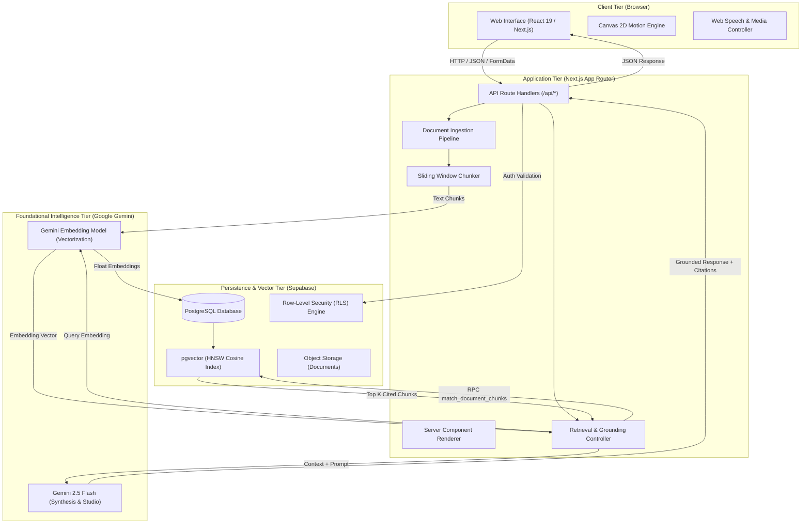
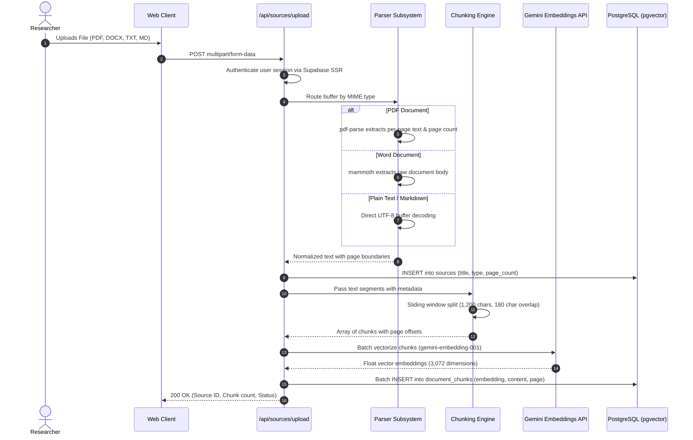

# SYNORA System Architecture Specification

This document provides a comprehensive technical overview of the architectural design, data pipelines, retrieval-augmented generation (RAG) mechanics, and security controls powering SYNORA.

---

## 1. High-Level System Architecture

SYNORA is structured as a full-stack, decoupled Next.js application utilizing React Server Components (RSC), App Router server route handlers, an embedded vector store via PostgreSQL `pgvector`, and Google Gemini foundational intelligence models.



---

## 2. Ingestion & Document Processing Pipeline

The ingestion pipeline transforms unstructured heterogeneous documents into normalized, indexed vector representations while preserving page numbers and source metadata.



### Chunking Specification
- **Window Size**: 1,200 characters per chunk.
- **Window Overlap**: 180 characters to preserve boundary context across sentences.
- **Metadata Persistence**: Each chunk records its originating `source_id`, `notebook_id`, `page_number`, and character start/end positions.

---

## 3. Retrieval-Augmented Generation (RAG) Architecture

SYNORA prioritizes precision and grounding over generative extrapolation. Every answer produced in the Research Workspace is verified against source chunks retrieved via semantic similarity.

### 3.1 Vector Indexing
Embeddings are indexed in PostgreSQL using an **Hierarchical Navigable Small World (HNSW)** cosine distance index:

```sql
CREATE INDEX document_chunks_embedding_idx 
ON public.document_chunks 
USING hnsw (embedding vector_cosine_ops)
WITH (m = 16, ef_construction = 64);
```

### 3.2 Similarity Matching Function
Retrieval executes through a parameterized database stored procedure (`match_document_chunks`) that enforces strict notebook isolation prior to index querying:

```sql
CREATE OR REPLACE FUNCTION match_document_chunks(
    query_embedding vector(3072),
    match_notebook uuid,
    match_count int DEFAULT 8
)
RETURNS TABLE (
    id uuid,
    source_id uuid,
    content text,
    page_number int,
    similarity float
)
LANGUAGE plpgsql
SECURITY DEFINER
AS $$
BEGIN
    RETURN QUERY
    SELECT
        dc.id,
        dc.source_id,
        dc.content,
        dc.page_number,
        1 - (dc.embedding <=> query_embedding) AS similarity
    FROM public.document_chunks dc
    WHERE dc.notebook_id = match_notebook
    ORDER BY dc.embedding <=> query_embedding
    LIMIT match_count;
END;
$$;
```

### 3.3 Strict Grounding Protocol
When synthesizing research responses, the system assembles a system prompt that mandates:
1. Every factual assertion must be attributed to an extracted citation chunk using numeric notation `[^1]`.
2. Extrapolations or external hallucinations are explicitly forbidden when the context lacks sufficient evidence.
3. If source documents contain contradictory statements, both views must be synthesized and attributed with respective source citations.

---

## 4. Studio Synthesis Engine

The Studio Engine (`/api/studio`) transforms notebook source material into structured learning and analytical artifacts using deterministic schemas:

| Artifact Kind | Output Format | Purpose |
| :--- | :--- | :--- |
| `guide` | Structured Markdown | Comprehensive research briefing with executive summary and key findings. |
| `flashcards` | JSON Array (`front`, `back`, `tag`) | Active recall flashcards with 3D flip card visual rendering. |
| `quiz` | JSON Array (`question`, `options`, `correctIndex`, `explanation`) | Multi-choice diagnostic assessment with interactive grading. |
| `faq` | JSON Array (`question`, `answer`) | Core reference questions extracted directly from primary sources. |
| `mindmap` | Markdown hierarchy / Graph | Conceptual topic breakdown showing parent-child domain relationships. |
| `timeline` | Chronological JSON array | Event sequence reconstruction with associated source citations. |
| `compare` | Markdown tabular matrix | Side-by-side synthesis contrasting methodologies, theories, or claims. |
| `contradiction` | Analytical Markdown | Discrepancy detector flagging conflicting evidence across documents. |

---

## 5. Security & Isolation Boundary

1. **Authentication**: Managed via Supabase Auth with secure HTTP-only cookies processed by `@supabase/ssr`.
2. **Authorization**: PostgreSQL Row-Level Security (RLS) is enabled on all tables (`notebooks`, `sources`, `document_chunks`, `messages`, `notes`, `study_materials`, `shares`).
3. **API Key Isolation**: `GEMINI_API_KEY` and Supabase service role keys are accessible solely within server route handlers. No API keys are bundled into client JavaScript.
4. **Data Isolation**: Multi-tenant database queries enforce `auth.uid() = user_id` on all operations.
